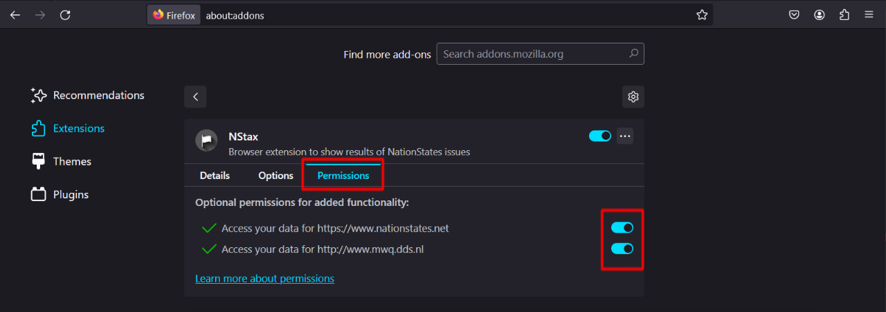
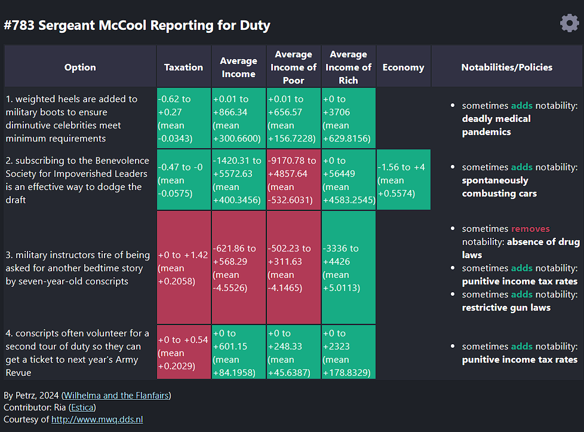

# NStax

A browser extension to show results of NationStates issues

## Installation

### Chrome, Edge, Opera GX, and Other Chromium-based browsers

1. Download `NStax-x.y.z-chrome.zip` [here](https://github.com/callmepeterz/NStax/releases/latest).
2. Extract the downloaded file.
2.  - **Chrome**: Go to `chrome://extensions`, enable Developer mode, and load the unpacked extension from the extracted folder.
    - **Edge**: Go to `Settings and more` (3-dot menu in the top right corner), select `Extensions`, enable Developer mode, and load the temporary add-on from the extracted folder.
    - **Opera GX**: Go to `opera:extensions`, enable Developer mode, and load the unpacked extension from the extracted folder.

### Firefox

1. Download `NStax-x.y.z-firefox.zip` [here](https://github.com/callmepeterz/NStax/releases/latest).
2. Extract the downloaded file.
3. Go to `about:debugging#/runtime/this-firefox` and load the temporary add-on from the extracted folder.
4. Go to `about:addons`, select the NStax extension, go to `Permissions`, and turn on all permissions for the extension.

## To configure stats shown

Go to the Options page by clicking on the **Gear Icon** in the top right corner of the pop-up, or right-clicking on the extension icon in the toolbar and selecting `Options` (`Extension option` if you're using Edge). Configure the stats you would like to be shown. Check the `Positive` checkbox if you prefer the entered stat to increase and uncheck the checkbox if you prefer the stat to decrease. Check the `Show Notabilities/Policies` if you would like notabilities and policies to be shown. Click `Save` to save changes.

## To use

Run the extension **while you are on the issue page** and the extension pop-up should look like this:

